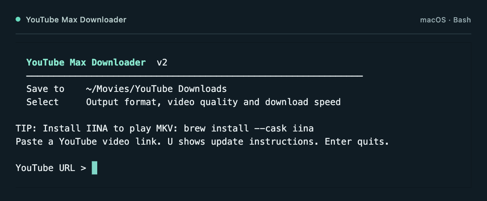
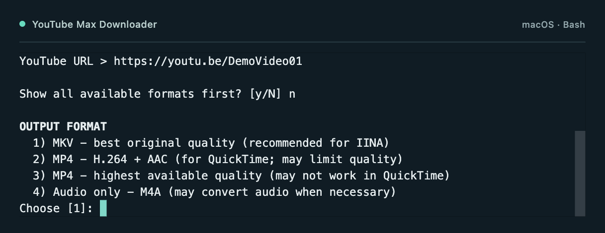
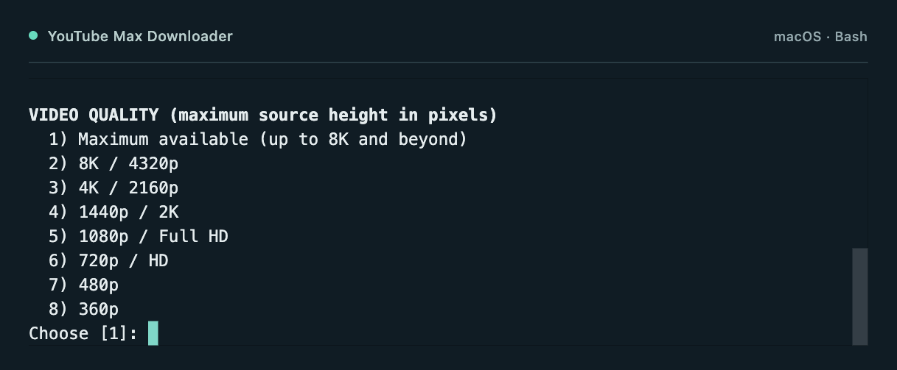

<div dir="rtl" lang="ar">

<h1 align="center"><a href="docs/brand/logo.png"></a></h1>

<p align="center">احفظ الفيديو بترميز المصدر، أو اختر MP4 مناسبًا لـ QuickTime، أو استخرج الصوت في ملف M4A.</p>

<p align="center" dir="ltr">
  <a href="https://github.com/ikhd/youtube-max-downloader/archive/refs/heads/main.zip"></a>
  <a href="YouTube-Max-Windows-Trial.zip?raw=true"></a>
</p>

<p align="center"><a href="README.md">English</a> &nbsp;·&nbsp; <a href="docs/TESTING.md">نتائج الاختبارات</a> &nbsp;·&nbsp; <a href="LICENSE">ترخيص MIT</a></p>

## 🚀 ابدأ على جهازك

| النظام | بعد تنزيل الملف وفك ضغطه | مجلد الحفظ |
| --- | --- | --- |
| **macOS** | انقر مرتين على <code>YouTube-Max-v2.command</code>، أو شغّله من Terminal. | <code>~/Movies/YouTube Downloads</code> |
| **Windows · تجريبي** | انقر مرتين على <code>YouTube-Max.cmd</code>. يثبّت WinGet الأدوات الناقصة، ثم تظهر خانة الرابط. | <code>%USERPROFILE%\Videos\YouTube Downloads</code> |

يمكن تشغيل النسختين من ملف ZIP دون تثبيت Git. على Windows، أبقِ <code>downloader.ts</code> بجوار المشغّل. يعمل Turbo حتى عند غياب aria2c. [مساعدة Windows](YouTube-Max-Windows-Trial/README-FIRST.txt)



### إعداد أدوات الماك

1. افتح Terminal داخل مجلد المشروع وافحص الأدوات. يستخدم السكربت Bash المرفق مع macOS، ويبحث في PATH ومساري Homebrew المعتادين على Apple Silicon وIntel.

   ```sh
   ./YouTube-Max-v2.command --check
   ```

2. إذا كنت تستخدم Homebrew وظهر أن بعض الأدوات ناقصة، يمكنك تثبيتها بالأمر التالي. تتضمن حزمة FFmpeg أداتي `ffmpeg` و`ffprobe`. يستخدم yt-dlp برنامج Deno لتشغيل مكوّنات JavaScript الخاصة بـ YouTube. [Homebrew](https://brew.sh/) · [متطلبات yt-dlp](https://github.com/yt-dlp/yt-dlp/wiki/EJS)

   ```sh
   brew install yt-dlp ffmpeg deno
   ```

3. انقر مرتين على **YouTube-Max-v2.command** في Finder، أو شغّله من Terminal. إذا فقد الملف صلاحية التشغيل عند نسخه، نفّذ `chmod +x YouTube-Max-v2.command` مرة واحدة.

   ```sh
   ./YouTube-Max-v2.command
   ```

يمكن إضافة aria2 للتنزيل المباشر في وضع Turbo عبر `brew install aria2`، أو مشغّل IINA عبر `brew install --cask iina`. يستأذنك البرنامج قبل التثبيت التفاعلي. كتابة **U** عند خانة الرابط تعرض تعليمات التحديث فقط.

## 🎬 تنزيل فيديو

الصق رابط HTTPS لفيديو تملكه أو لديك إذن بتنزيله. يقبل البرنامج روابط المشاهدة وShorts والبث المباشر والتضمين وروابط youtu.be. يستخرج معرّف فيديو واحد ويتجاهل معاملات قائمة التشغيل والتتبّع ووقت البدء. إذا أجبت **y** لعرض الصيغ المتاحة، يتصل البرنامج بـ YouTube. في القوائم المرقّمة يقبل **Enter** الخيار الافتراضي.

لتجربة فيلم Blender المفتوح بدقة أقصاها 360p، نفّذ الأمر أدناه. اختر **n** لتجاوز عرض الصيغ، ثم **1** لحاوية MKV، ثم **8** لحد 360p، ثم **1** للسرعة المتوازنة. تمرير الرابط في أمر التشغيل ينهي الجلسة بعد فيديو واحد. التشغيل دون رابط يسمح بتنزيل فيديو آخر في الجلسة نفسها. [الفيلم وترخيصه](https://peach.blender.org/about/)

```sh
./YouTube-Max-v2.command 'https://www.youtube.com/watch?v=aqz-KE-bpKQ'
```

### صيغة الملف

| الخيار | الناتج | كيف يختاره البرنامج |
| --- | --- | --- |
| **1 · Original-MKV** | MKV | يجمع أفضل مساري فيديو وصوت متاحين، أو يستخدم مسارًا يجمعهما. يحتفظ بترميز المصدر. |
| **2 · Apple-MP4** | MP4 | يختار فيديو H.264/AVC وصوت AAC. تعتمد الدقة الممكنة على توفرهما. إذا غاب أحدهما يفشل الطلب. |
| **3 · Max-MP4** | MP4 | يضع أفضل المسارات المطابقة في MP4. قد لا يشغّل جهازك الترميز المتاح، وقد يرفض FFmpeg تركيبة غير مناسبة للحاوية. |
| **4 · Audio-M4A** | M4A | يفضّل مسار M4A جاهزًا، ثم أي مسار صوتي، ثم يستخرج الصوت من مسار مدمج. قد يعيد ترميز الصوت، مثل تحويل Opus إلى AAC. |

**تغيير الحاوية (remux)** ينقل المسارات المُرمّزة إلى ملف بحاوية أخرى دون إعادة ترميزها. **إعادة الترميز (transcode)** تفك ترميز المسار وتُرمّزه مجددًا. تطلب خيارات الفيديو الدمج أو تغيير الحاوية، بينما يسمح خيار M4A بتحويل الصوت عند الحاجة. [شرح FFmpeg](https://ffmpeg.org/ffmpeg.html#Streamcopy)



### الدقة وسرعة التنزيل

| الدقة | معنى الاختيار |
| --- | --- |
| **Maximum**، الافتراضي | أفضل دقة يوفرها المصدر ضمن خيار الحفظ. |
| **4320p · 2160p · 1440p · 1080p · 720p · 480p · 360p** | حدّ أعلى **لارتفاع الفيديو بالبكسل**. تُستبعد الصيغ مجهولة الارتفاع. فيديو Shorts بعرض 1080 وارتفاع 1920 يتجاوز سقف 1080p. قد يختار البرنامج دقة أصغر متوفرة. |

يُطبّق الحدّ على الصيغ المتاحة من المصدر دون تغيير أبعاد الفيديو. اختيار الصوت وحده يتجاوز قائمة الدقة.



| السرعة | عدد الأجزاء المتزامنة | طريقة النقل |
| --- | ---: | --- |
| **Balanced** | 4 | خيار مناسب للبدء إذا كان الاتصال يتقطع أو يحدّ الخادم من الطلبات. |
| **Fast**، الافتراضي | 8 | يستخدم تنزيل الأجزاء المدمج في yt-dlp عندما يدعمه المصدر. |
| **Turbo** | 16 | يستعين بـ aria2c إن كان مثبتًا، وبما يصل إلى ثمانية اتصالات للنقل المباشر المناسب. تستخدم تدفّقات DASH وHLS أداة التنزيل المدمجة. |

تتأثر السرعة بالخادم والبروتوكول والاتصال. قد لا تؤدي زيادة عدد الأجزاء إلى أي تحسّن. [خيارات yt-dlp](https://github.com/yt-dlp/yt-dlp#download-options) · [دليل aria2](https://aria2.github.io/manual/en/html/aria2c.html)

## 📁 الملفات والاستئناف والتشغيل

- يتضمن الاسم عنوان الفيديو ومعرّفه وخيار الحفظ، ويضاف الارتفاع الفعلي للفيديو. يتحقق التطبيق من وجود الملف النهائي. عند التشغيل التفاعلي يفتح المجلد في Finder ويعرض التشغيل في IINA إذا وجده في مجلد التطبيقات.
- إذا سألك Finder عن تطبيق لفتح MKV، اختر **فتح باستخدام ← IINA**. لجعله افتراضيًا لملفات MKV، افتح **إحضار المعلومات ← فتح باستخدام ← IINA ← تغيير الكل**. ولملف يناسب QuickTime اختر Apple-MP4. [مشغّل IINA](https://iina.io/)
- بعد الانقطاع اترك الملفات الجزئية في مكانها، وكرّر الرابط والإعدادات نفسها. يتوقف الاستئناف على دعم المصدر وتطابق الأسماء. إذا تعذّر جلب جزء بعد المحاولات، يتوقف التنزيل. يمنع قفل لكل معرّف نسختين من البرنامج من الكتابة إلى الفيديو نفسه في الوقت ذاته.
- عند وجود نسخة لنفس المعرّف وخيار الحفظ، يتحقق البرنامج من اسم الملف الذي تعطيه الصيغة المختارة حاليًا. إذا تطابق الاسم، يحتفظ بالملف دون تعديل محتواه. تغيير العنوان أو إعادة تسمية الملف قد ينتج اسمًا جديدًا. فحص الوجود لا يفحص سلامة محتوى ملف قديم.
- **Enter** عند خانة الرابط ينهي الجلسة، وكذلك انتهاء الإدخال عند تلك الخانة. الضغط على Ctrl-C أو انتهاء الإدخال أثناء اختيار الإعدادات يعيد الرمز **130**. معاملات التشغيل غير الصالحة تعيد **2**، وفشل التنزيل يعيد رمزًا غير صفري حتى عند مغادرة جلسة تفاعلية بعده.

## 🛠️ حل المشكلات

| ما يظهر | ما يمكنك فعله |
| --- | --- |
| أداة ناقصة أو خيار غير معروف | شغّل `--check` ثم `yt-dlp --version`. راجع الإصدار المتاح في مدير الحزم الذي استخدمته أصلًا. |
| الصيغة المطلوبة غير متاحة | اعرض الصيغ واختر ارتفاعًا متوفرًا أو ارفع الحدّ. اختر Original-MKV إذا غاب ترميز H.264 أو AAC. |
| ملف MP4 يعمل بصوت دون صورة | افحص ترميز الفيديو في IINA. اختر Apple-MP4 لنسخة ملائمة لـ QuickTime. |
| توقف النقل أو كثرت طلبات الاتصال | جرّب Balanced لاحقًا، واحتفظ بالملفات الجزئية للاستئناف. |
| فيديو خاص أو مقيّد أو غير متاح | استخدم رابطًا متاحًا لديك إذن بتنزيله. لا توجد خانة لحساب أو كوكيز في البرنامج. |

## 🔒 الخصوصية والاختبارات

يعمل السكربت محليًا ويمرّر الخيارات مباشرة إلى yt-dlp. يتلقى YouTube طلبات عرض الصيغ والتنزيل. يتيح الخيار `--remote-components ejs:npm` جلب مكوّنات EJS تنفيذية من npm عبر Deno عند الحاجة. يتجاهل التطبيق إعدادات yt-dlp الشخصية. يحفظ البيانات الوصفية المعتادة ويستبعد مرفق JSON الكامل، وقد يتضمن الملف العنوان ورابط المصدر. [توثيق EJS](https://github.com/yt-dlp/yt-dlp/wiki/EJS)

الصور مأخوذة من مخرجات عملية Bash حقيقية على macOS عبر طرفية افتراضية عُرضت باستخدام xterm.js. استُخدم معرّف تجريبي للوصول إلى القوائم. اختبار التنزيل المباشر أُجري بشكل مستقل على فيلم Blender المرخّص. [سجلّ الأوامر والنتائج](docs/TESTING.md) · [إرشادات المساهمة والإبلاغ](CONTRIBUTING.md)

</div>
