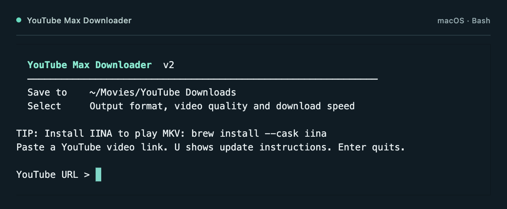
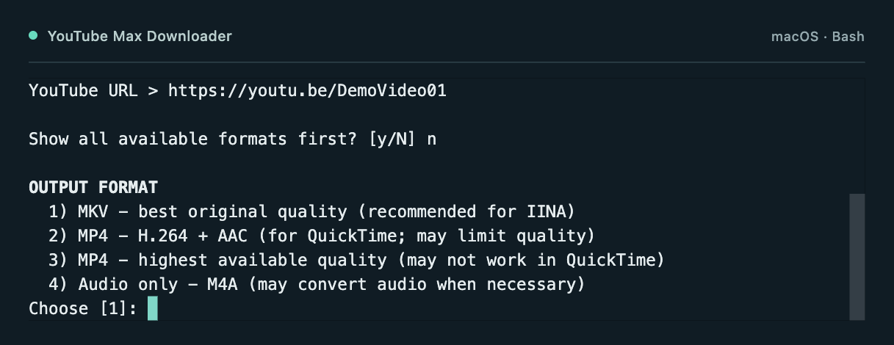
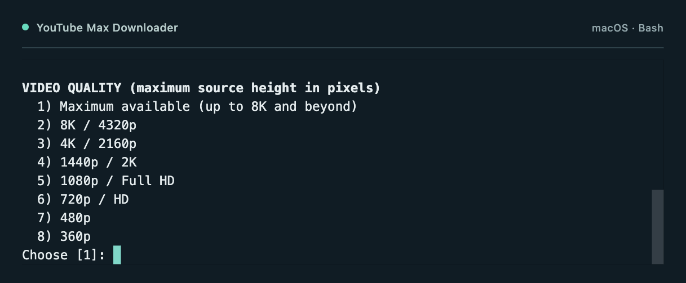

<h1 align="center"><a href="docs/brand/logo.png"></a></h1>

<p align="center">Keep the source codecs, choose a QuickTime-friendly MP4, or save just the audio as M4A.</p>

<p align="center" dir="ltr">
  <a href="https://github.com/ikhd/youtube-max-downloader/archive/refs/heads/main.zip"></a>
  <a href="YouTube-Max-Windows-Trial.zip?raw=true"></a>
</p>

<p align="center"><a href="README.ar.md" lang="ar">العربية</a> &nbsp;·&nbsp; <a href="docs/TESTING.md">Test results</a> &nbsp;·&nbsp; <a href="LICENSE">MIT License</a></p>

## 🚀 Quick start

| Platform | After you extract the ZIP | Download folder |
| --- | --- | --- |
| **macOS** | Double-click <code>YouTube-Max-v2.command</code>, or launch it from Terminal. | <code>~/Movies/YouTube Downloads</code> |
| **Windows · trial** | Double-click <code>YouTube-Max.cmd</code>. WinGet installs missing tools, then the URL prompt opens. | <code>%USERPROFILE%\Videos\YouTube Downloads</code> |

Both downloads work without Git. On Windows, keep <code>downloader.ts</code> beside the launcher. Turbo also works without optional aria2c. [Windows setup help](YouTube-Max-Windows-Trial/README-FIRST.txt)



### Set up the Mac tools

1. From the project folder in Terminal, check which tools are available. The script uses the Mac’s built-in Bash. It searches your PATH and both standard Homebrew locations.

   ```sh
   ./YouTube-Max-v2.command --check
   ```

2. If tools are missing and you use Homebrew, install the required packages. FFmpeg supplies both `ffmpeg` and `ffprobe`. Deno runs the JavaScript components used by yt-dlp for YouTube. [Homebrew](https://brew.sh/) · [yt-dlp runtime requirements](https://github.com/yt-dlp/yt-dlp/wiki/EJS)

   ```sh
   brew install yt-dlp ffmpeg deno
   ```

3. Double-click **YouTube-Max-v2.command** in Finder or run it in Terminal. If a copied file has lost its executable bit, run `chmod +x YouTube-Max-v2.command` first.

   ```sh
   ./YouTube-Max-v2.command
   ```

Optional tools are `aria2c` for direct HTTP transfers in Turbo mode (`brew install aria2`) and IINA for playback (`brew install --cask iina`). The interactive installer asks before calling Homebrew. Entering **U** at the URL prompt only prints update guidance.

## 🎬 Download a video

Paste an HTTPS watch, Shorts, live, embed or youtu.be link to a video you own or have permission to download. The app extracts the single video ID and discards playlist, tracking and timestamp parameters. The format-list prompt makes a network request if you answer **y**. Press **Enter** to accept a numbered menu’s default.

For example, to save Blender’s open film at up to 360 pixels high, run the command below. Answer **n**, then **1** for MKV, **8** for 360p and **1** for Balanced. A URL argument runs one download and returns its status. Launching without arguments keeps the URL prompt open for another video. [Film and license](https://peach.blender.org/about/)

```sh
./YouTube-Max-v2.command 'https://www.youtube.com/watch?v=aqz-KE-bpKQ'
```

### Output format

| Menu | File | What goes into it |
| --- | --- | --- |
| **1 · Original-MKV** | MKV | Best available video-only and audio-only streams, with a combined stream as fallback. Preserves source codecs. |
| **2 · Apple-MP4** | MP4 | Selects H.264/AVC video and AAC audio. Available resolution depends on those codecs. If no matching streams exist, the request fails. |
| **3 · Max-MP4** | MP4 | Packs the best matching source streams into MP4. Newer codecs can limit playback on your device. FFmpeg can reject an incompatible combination. |
| **4 · Audio-M4A** | M4A | Prefers an existing M4A stream, then another audio stream, then a combined source. Extraction can re-encode audio, for example Opus to AAC. |

**Remuxing** changes the container while preserving the encoded video and audio. **Transcoding** decodes and encodes a stream again. The video profiles request a merge or remux. The M4A profile permits audio conversion. [FFmpeg stream handling](https://ffmpeg.org/ffmpeg.html#Streamcopy)



### Quality and transfer settings

| Video quality | Selection |
| --- | --- |
| **Maximum** (default) | Best available for the selected profile. Source availability determines the ceiling. |
| **4320p · 2160p · 1440p · 1080p · 720p · 480p · 360p** | Strict maximum **source height**. Formats with unknown height are excluded. A 1080 × 1920 Short exceeds a 1080p cap. A smaller available format may be selected. |

Audio-only skips the quality menu. A quality cap filters existing streams. The app does not resize video.



| Speed | Concurrent fragments | Transfer behavior |
| --- | ---: | --- |
| **Balanced** | 4 | A starting point for unstable or rate-limited connections. |
| **Fast** (default) | 8 | Native yt-dlp fragment downloads for supported streams. |
| **Turbo** | 16 | Uses aria2c when installed for suitable direct transfers, with up to eight connections. DASH/HLS use the native downloader. |

The server, protocol and connection determine actual throughput. A higher fragment count may have no benefit. [yt-dlp options](https://github.com/yt-dlp/yt-dlp#download-options) · [aria2 options](https://aria2.github.io/manual/en/html/aria2c.html)

## 📁 Files, retries and playback

- Names include the title, video ID, profile and, for video, the selected height. The app verifies the final file before reporting success. In an interactive Terminal it opens the folder in Finder and offers playback if IINA is installed in Applications.
- If Finder asks which app to use for MKV, choose **Open With → IINA**. To set this for future MKVs, use **Get Info → Open with → IINA → Change All**. Apple-MP4 is the QuickTime-oriented choice. [IINA](https://iina.io/)
- After an interruption, keep the partial files and rerun the same link and settings. Resume depends on the source and matching filenames. After retries, an unavailable fragment fails the job. A per-video lock prevents simultaneous writes by two copies of the app.
- If an output for that video and profile already exists, the app resolves the current selection. An exact filename match is reused without modifying its contents. Renaming a file or a change to the source title can produce a new filename. Existing files are checked for presence, not for media integrity.
- An empty URL or end-of-input at the URL prompt exits. Ctrl-C or end-of-input during selection returns **130**. Invalid command-line arguments return **2**. A failed download produces a nonzero exit, including when quitting a multi-download session afterwards. Run `./YouTube-Max-v2.command --help` for usage.

## 🛠️ Troubleshooting

| Symptom | Next step |
| --- | --- |
| Missing tool or unrecognized yt-dlp option | Run `--check` and `yt-dlp --version`. Review updates in your original package manager. |
| “Requested format is not available” | List formats. Select an available height, raise the cap, or choose Original-MKV if the source lacks H.264 or AAC. |
| MP4 has sound but no picture | Check the video codec in IINA. For a QuickTime-oriented copy, select Apple-MP4. |
| Transfer stalls or is rate limited | Retry later with Balanced. Keep partial files for the retry. |
| A private, restricted or unavailable video fails | Use an accessible video you have permission to download. This app has no account or cookie input. |

## 🔒 Privacy and verification

The wrapper runs locally and passes arguments directly to yt-dlp. YouTube receives network requests for listing and downloading. With `--remote-components ejs:npm`, yt-dlp may fetch executable EJS components through Deno from npm. The app ignores user yt-dlp configuration, embeds ordinary media metadata and suppresses the full info-JSON attachment. Titles and source URLs can still appear in the saved file. [Upstream EJS documentation](https://github.com/yt-dlp/yt-dlp/wiki/EJS)

The screenshots show real menu output captured from the macOS Bash process in a pseudo-terminal and rendered in xterm.js. The sample ID was used to reach the menus. The separate live test used Blender’s licensed film. Commands, versions and measured outcomes are in the [verification record](docs/TESTING.md). For changes or private issue reports, see [contributor guidance](CONTRIBUTING.md).
